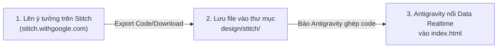

# 🎨 THƯ MỤC THIẾT KẾ GOOGLE STITCH (`design/stitch/`)

> *Nơi lưu trữ các bản thiết kế giao diện (UI templates/mockups) xuất từ Google Stitch (`stitch.withgoogle.com`) để Antigravity tích hợp vào mã nguồn chính của Dashboard.*

---

## 1. CÁC FILE MẪU HIỆN CÓ
1. [`modal_detail.html`](./modal_detail.html): 
   - Mẫu thiết kế Modal xem chi tiết phân tích từng mã cổ phiếu (Thị giá, MA10/50, Nền tích lũy, P/E, P/B, ROE, RSI, vị trí trong nền).
   - Có thể mở file này trực tiếp bằng trình duyệt để xem trước.
2. [`portfolio_card.html`](./portfolio_card.html):
   - Mẫu thiết kế Widget Quản lý danh mục cá nhân & Cảnh báo thông minh AI thời gian thực (Tổng tài sản, PnL %, Tỷ trọng, danh sách mã đang nắm giữ và cảnh báo vi phạm MA).

---

## 2. QUY TRÌNH LÀM VIỆC VỚI GOOGLE STITCH



### Bước 1: Tạo giao diện trên Stitch
Truy cập [stitch.withgoogle.com](https://stitch.withgoogle.com/) và dùng Prompt chuẩn Design System của dự án:
```text
Thiết kế component phân tích cổ phiếu theo phong cách Dark Mode chuyên nghiệp:
- Nền tối: #0b0e14 và #12161f
- Thẻ Card: #181e2b viền #242d3d
- Màu điểm nhấn (Accent): Xanh lục Emerald (#10b981)
- Typography: Font Inter / Sans-serif hiện đại
- Sử dụng Lucide Icons dạng nét mỏng
- Tích hợp số liệu: Thị giá realtime, MA10, MA50, Thời gian nền tích lũy, P/E, ROE
```

### Bước 2: Tải code về
Chọn **Export Code** (hoặc copy mã HTML + Tailwind) và lưu file vào thư mục `design/stitch/` này (ví dụ: `my_new_widget.html`).

### Bước 3: Yêu cầu Antigravity tích hợp
Chỉ cần gõ trong chat:
> *"Antigravity hãy đọc file `design/stitch/my_new_widget.html` và tích hợp vào `index.html`, nối dữ liệu thực tế từ `StockApp.stocks`."*
